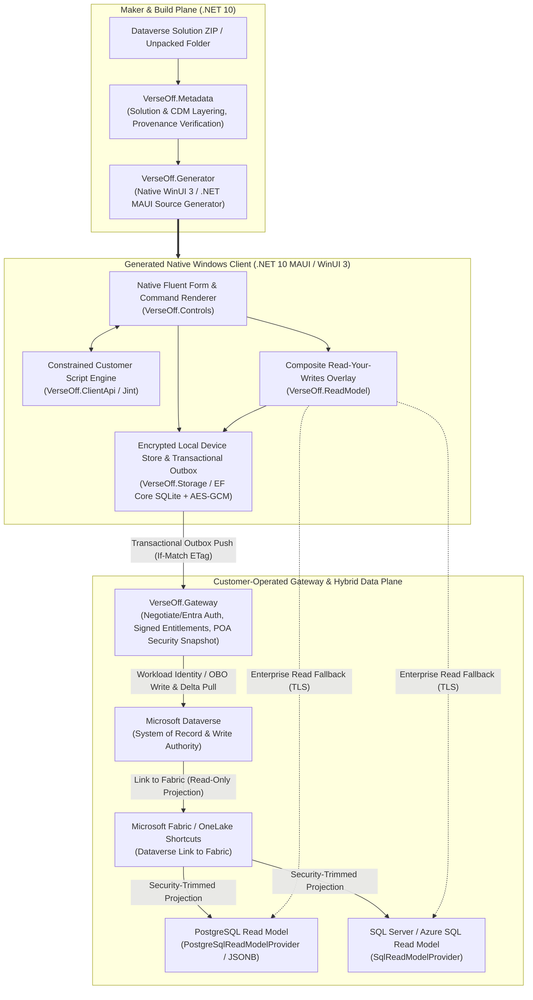

# VerseOff — Native Dynamics 365 & Dataverse Offline Client Engine

**VerseOff** is a Microsoft-aligned, Windows-first native application and source-code generation engine built on **C#, .NET 10 LTS, .NET MAUI / WinUI 3, XAML, EF Core SQLite, and a constrained Jint runtime**. It ingests customer-owned Microsoft Dataverse model-driven app solutions and generates standalone, offline-capable native desktop applications with transactional outbox synchronization and a hybrid enterprise read plane (**Microsoft Fabric Link / OneLake → PostgreSQL & SQL Server**).

> **Strict Provenance & Fail-Closed Boundary:** VerseOff only transforms and executes verified customer-authored or VerseOff-owned assets. Microsoft OOTB/internal scripts and third-party proprietary bundles are never decompiled, transpiled, redistributed, or executed. Unknown-provenance assets fail closed.

---

## Canonical Architecture Documentation

- [Native Microsoft Architecture](docs/NATIVE_MICROSOFT_ARCHITECTURE.md)
- [Hybrid Data and Channel Integration (Fabric Link, PostgreSQL, SQL Server, Outbox)](docs/HYBRID_DATA_AND_CHANNEL_INTEGRATION.md)
- [ALM, Profiles, Distribution, and Extensibility](docs/ALM_PROFILES_DISTRIBUTION_EXTENSIBILITY.md)
- [License-Bound Distribution and Authentication](docs/LICENSE_BOUND_DISTRIBUTION_AND_AUTHENTICATION.md)
- [Regulated Enterprise Acceptance](docs/REGULATED_ENTERPRISE_ACCEPTANCE.md)
- [Gateway API Reference](docs/GATEWAY_API.md) & [OpenAPI Specification](docs/openapi.yaml)

---

## System Architecture



---

## Core Capabilities

### 1. Faithful Native Model-Driven App Generation (`VerseOff.Metadata` & `VerseOff.Generator`)
- **Solution & CDM Layering**: Imports Dataverse solution packages (`.zip` or unpacked folders), layers customer customizations over standard Common Data Model (CDM) schemas (`account`, `contact`, `incident`, `opportunity`, `lead`, `quote`, `salesorder`), and verifies publisher provenance via SHA-256 digests.
- **Native WinUI 3 / MAUI Rendering**: Generates a standalone `.csproj` desktop application rendering SiteMap navigation, multi-tab/multi-column forms, header and footer regions, Business Process Flows (BPF), Subgrids, Lookups, OptionSets, Timeline views, and Ribbon command bars.
- **Declarative Command & Visibility Rules**: Evaluates deterministic `ValueRule`, `FormStateRule`, and `EntityPrivilegeRule` definitions against the local record and security snapshot, failing closed on unverified custom rules.

### 2. Hybrid Read Plane: Fabric Link → PostgreSQL & SQL Server (`VerseOff.ReadModel`)
- **Dataverse as Sole Write Authority**: All creates, updates, and deletes flow through the local transactional outbox to Dataverse so server plug-ins, workflows, and optimistic concurrency (`If-Match` ETags) remain authoritative.
- **Fabric Link / OneLake Read Projections**: High-volume lookups, homepage views, and historical queries are served from security-trimmed projections fed by **Dataverse Link to Microsoft Fabric**:
  - **`PostgreSqlReadModelProvider`**: Queries `verseoff.read_projection` using parameterized PostgreSQL `JSONB` path extraction (`jsonb_extract_path_text`) and `ILIKE` search over verified TLS (`SSL Mode=Require|VerifyCA|VerifyFull`).
  - **`SqlReadModelProvider`**: Queries `dbo.VerseOffReadProjection` on SQL Server / Azure SQL / Fabric SQL over mandatory encrypted TLS connections.
- **Read-Your-Writes Overlay (`CompositeReadModelProvider`)**: Automatically overlays local uncommitted outbox creates, updates, and tombstones onto enterprise read-model pages so users immediately see their offline mutations.

### 3. Enterprise Security & POA Snapshot Projection (`VerseOff.Domain` & `VerseOff.Gateway`)
- **Zero Client Secrets on Device**: The desktop client never holds Dataverse client secrets. `VerseOff.Gateway` authenticates users via Entra ID / Windows Negotiate and issues short-lived, cryptographically signed entitlement leases.
- **POA-Aware Security Snapshots (`SecuritySnapshotProjector`)**: Projects direct user roles, team memberships, role privilege depths (`User`, `BusinessUnit`, `ParentChildBusinessUnit`, `Organization`), field-level column security policies, and Dataverse `PrincipalObjectAccess` (POA) record grants into a versioned per-user snapshot without exposing raw security tables to the device.
- **Encrypted Local Storage (`AesGcmLocalDataProtector`)**: Protects cached records, outbox payloads, and Dataverse change-tracking delta cursors at rest in SQLite using authenticated AES-GCM encryption bound to record-specific purposes.

### 4. Constrained Customer Script Sandbox (`VerseOff.ClientApi`)
- Executes only SHA-256 verified, customer-owned JavaScript web resources inside a memory-, recursion-, and timeout-bounded **Jint** engine (`onLoad`, `onChange`, `onSave`, and Ribbon command actions).
- Provides a deterministic `Xrm.Page` / `formContext` execution model with dirty-state tracking, field validation, and notifications while blocking network access, DOM scraping, and dynamic code evaluation.

---

## Repository Structure

```text
VerseOff/
├── native/
│   ├── VerseOff.Native.sln                # Primary .NET 10 Solution
│   ├── Directory.Build.props              # Strict nullable, deterministic, warnings-as-errors config
│   ├── src/
│   │   ├── VerseOff.App/                  # Native WinUI 3 / MAUI Maker Studio Desktop App
│   │   ├── VerseOff.Maker/                # CLI Maker Tool (verseoff-maker)
│   │   ├── VerseOff.Domain/               # Domain models, POA SecuritySnapshotProjector, provenance
│   │   ├── VerseOff.Metadata/             # Dataverse solution ZIP importer, FormXML/Ribbon/SiteMap parsers, CDM catalog
│   │   ├── VerseOff.Generator/            # Native MAUI/WinUI C# & XAML target project generator
│   │   ├── VerseOff.Controls/             # Native form host, BPF, Subgrid, Timeline, and Command evaluators
│   │   ├── VerseOff.ClientApi/            # Constrained Jint Xrm execution sandbox & event pipeline
│   │   ├── VerseOff.Storage/              # EF Core SQLite store, transactional outbox, AES-GCM data protector
│   │   ├── VerseOff.ReadModel/            # Local EF, SQL Server, and PostgreSQL (Fabric Link) read-model providers
│   │   ├── VerseOff.Sync/                 # Dataverse delta-link pull coordinator & optimistic-concurrency push
│   │   ├── VerseOff.Customization/        # Declarative YAML/JSON form, view, and event customization layer
│   │   ├── VerseOff.Gateway/              # Enterprise ASP.NET Core gateway (Negotiate auth, metadata & sync endpoints)
│   │   └── VerseOff.Integrations/         # Mail (Graph/Outlook) and CTI channel adapters
│   └── tests/                             # 11 MSTest suites covering all native libraries
├── scratch/
│   └── GenerateSample/                    # Generates the ContosoService / Automotive sample target into C:\vo-target
├── docs/                                  # Canonical architecture, security, hybrid data, and OpenAPI specs
└── legacy/
    └── python_prototype/                  # Archived R&D Python/PyQt6 prototype and behavioral fixtures
```

---

## Quick Start

### Prerequisites
- Windows 10/11 (x64)
- [.NET 10 SDK](https://dotnet.microsoft.com/) (`10.0.200` or newer with `.NET MAUI` workload installed)

### 1. Build & Run the Native Test Suite
```powershell
dotnet test native\VerseOff.Native.sln -c Release
```

### 2. Generate & Launch the Sample Native Offline Client (`ContosoService`)
Generate a complete native Windows offline client from synthetic customer-owned metadata (Accounts, Contacts, Cases, Opportunities, BPFs, Ribbon commands, and customer scripts):

```powershell
dotnet run --project scratch\GenerateSample\GenerateSample.csproj -c Release
dotnet build C:\vo-target\ContosoService.csproj -c Release
dotnet run --project C:\vo-target\ContosoService.csproj -c Release --no-build
```
Or simply run `run_target_app.bat`.

### 3. Launch the VerseOff Maker Studio UI or CLI
Launch the native desktop Maker Studio:
```powershell
run_maker.bat
```
Or generate an offline package from an exported Dataverse solution via the CLI:
```powershell
dotnet run --project native\src\VerseOff.Maker\VerseOff.Maker.csproj -c Release -- generate --solution path\to\CustomerSolution.zip --output C:\vo-output
```

---

## License

MIT
